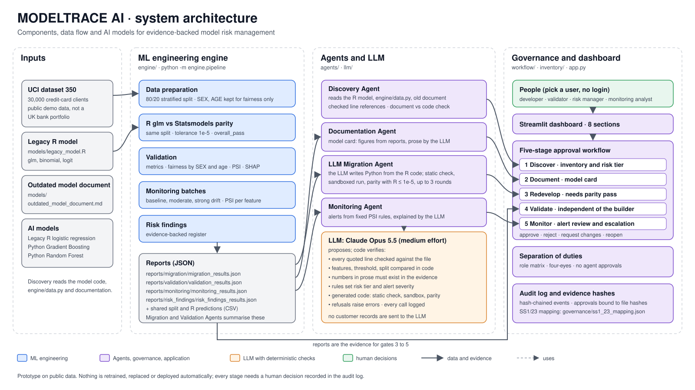
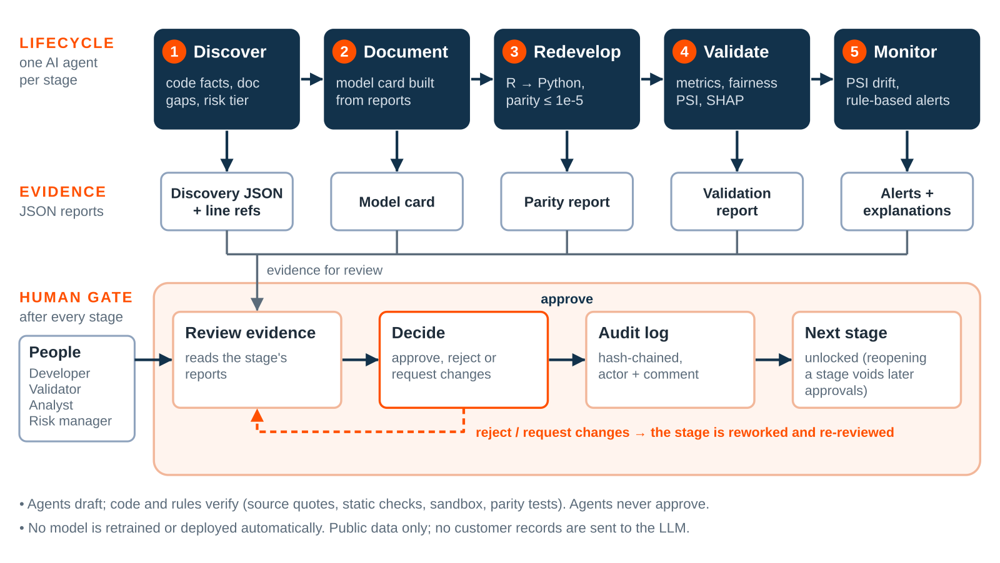

# MODELTRACE AI

### An agentic model risk factory that discovers, documents, redevelops, validates, and monitors a bank's models, with a human approval gate at every stage.

**Jump to:** [Problem](#the-problem) · [Solution](#what-modeltrace-ai-does) · [Results](#headline-results) · [Architecture](#system-architecture) · [Agents](#ai-agents-governance-and-dashboard) · [Reports](#automated-pdf-model-risk-reports) · [Quick Start](#quick-start) · [CLI](#command-line-agent-usage) · [Limitations](#known-limitations-and-scope)

## Demo Video

[▶ Watch MODELTRACE AI – Project Demonstration](https://drive.google.com/file/d/1Xy5f7FgsODnLROSPzcXega5wFj3Mr7_f/view?usp=sharing)

[📄 View Example MODELTRACE AI – PDF Reports](https://drive.google.com/drive/folders/176JaRgH9wxkG0bNtzXlF9dck8KA2yTFK?usp=sharing)

**System architecture**



**Process flow and use cases**



### Contents

| Overview | Architecture & Implementation | Running It | Responsibility & Scope |
|---|---|---|---|
| [Challenge 04](#challenge-04--agentic-model-risk-factory) | [System Architecture](#system-architecture) | [Quick Start](#quick-start) | [Responsible AI](#responsible-ai) |
| [The Problem](#the-problem) | [Dataset and Model Portfolio](#dataset-and-model-portfolio) | [Command-Line Agent Usage](#command-line-agent-usage) | [Judging Criteria Alignment](#alignment-with-hackathon-judging-criteria) |
| [What MODELTRACE AI Does](#what-modeltrace-ai-does) | [ML Engineering Implementation](#ml-engineering-implementation) | [Scoring the Discovery Agent](#scoring-the-discovery-agent) | [Known Limitations and Scope](#known-limitations-and-scope) |
| [Why It Is Trustworthy](#why-it-is-trustworthy) | [AI Agents, Governance and Dashboard](#ai-agents-governance-and-dashboard) | [MLflow Tracking](#mlflow-tracking) | [Our Objective](#our-objective) |
| [Headline Results](#headline-results) | [Governance and Human Approval](#governance-and-human-approval) | [Tests and Reproducibility](#tests-and-reproducibility) | |
| [Business Impact](#business-impact) | [Automated PDF Reports](#automated-pdf-model-risk-reports) | [Technology Stack](#technology-stack) | |
| | [Dashboard](#dashboard) | | |

---

## Challenge 04 — Agentic Model Risk Factory

**The challenge:** Build an AI-native, agentic factory to document, redevelop, and validate a bank's model inventory.

The challenge describes a Tier-1 UK bank managing approximately 250 credit, fraud, and pricing models built across SAS, R, and Python. Under the principles of PRA Supervisory Statement SS1/23, these models require appropriate documentation, independent validation, monitoring, and governance.

However, outdated documentation, fragmented model evidence, and validation cycles that can take 8–12 weeks create significant operational challenges.

These figures describe the illustrative client context provided in the hackathon brief. MODELTRACE AI demonstrates a technical approach using three sample models and public data; it does not claim to process an actual 250-model bank portfolio.

### What the challenge asks us to build

| Challenge requirement | MODELTRACE AI implementation |
|---|---|
| Document 3–5 sample models and build inventory records | Three registered models with inventory records, source references, discovery findings, and model documentation |
| Redevelop one SAS or R model in Python with parity proof | LLM-assisted R-to-Python redevelopment, isolated execution, and quantitative prediction-parity testing |
| Automatically generate validation reports | Performance, stability, fairness, and risk evidence |
| Introduce continuous monitoring | Simulated monitoring batches, PSI-based alerts, and AI-generated alert explanations |
| Keep humans involved at every stage | Role-separated approval workflow, human review gates, and hash-chained audit logging |

Our implementation follows the suggested lifecycle:

**Discover → Document → Redevelop → Validate → Monitor**

The platform combines GenAI and specialised agents, predictive analytics, reproducible ML engineering, and responsible AI controls. Every lifecycle stage produces evidence for human review rather than allowing an AI agent to make autonomous governance decisions.

*The hackathon challenge and client context are illustrative and subject to EXL confirmation. The demonstration uses public data and sample model implementations, not confidential bank data or production systems.*

---

## The Problem

A large financial institution may operate hundreds of models across different teams, technologies, and business functions.

Over time, model documentation can become outdated, legacy implementations can become difficult to maintain, and validation evidence can become scattered across systems.

This creates several challenges:

- **Documentation gaps:** Existing documents may no longer accurately describe the model's implementation.
- **Legacy technology:** Models written in SAS or R can be difficult to maintain or migrate.
- **Fragmented validation:** Performance, stability, fairness, and migration evidence may exist in separate locations.
- **Monitoring overhead:** Identifying and investigating model drift requires ongoing effort.
- **Governance complexity:** Approval responsibilities, evidence, and decisions must be traceable.
- **Manual reporting:** Producing consistent model-level and portfolio-level reports can be time-consuming.

MODELTRACE AI addresses these challenges by connecting the model lifecycle through a unified, evidence-driven workflow.

---

## What MODELTRACE AI Does

MODELTRACE AI transforms traditionally disconnected model risk activities into a human-in-the-loop pipeline.

AI agents handle specialised tasks, reproducible ML components generate quantitative evidence, and designated human reviewers retain control over lifecycle decisions.

| Stage | What happens | SS1/23 connection |
|---|---|---|
| **1. Discover** | Scans source code and documents, builds model inventory records, assigns a rule-based risk tier, and identifies discrepancies between implementation and documentation | Model inventory and tiering (1.2, 1.3) |
| **2. Document** | Generates structured model cards using verified metadata and available results, without inventing missing information | Development documentation (3.5) |
| **3. Redevelop** | Uses an LLM to rewrite a legacy R model in Python, checks and executes the candidate in isolation, and tests prediction parity against R | Development testing (3.3) |
| **4. Validate** | Evaluates available performance, stability, fairness, and explainability evidence, with validation separated from redevelopment | Independent validation (4.1, 4.2) |
| **5. Monitor** | Analyses simulated production batches, detects drift through rule-based thresholds, and generates explanations for alerts | Performance monitoring, exceptions, and escalations (4.4, 5.3) |
| **All stages** | Supports human approval, rejection, and requests for changes, with actions recorded in a hash-chained audit log | Governance (2.3, 2.4) |

The SS1/23 references are indicative mappings to relevant principles, not a claim of regulatory compliance.

---

## Why It Is Trustworthy

MODELTRACE AI is designed around evidence rather than unrestricted LLM-generated decisions.

- **The LLM never decides:** Rules and code determine drift severity, risk tier, and approval eligibility. The LLM drafts and explains findings.
- **Every claim is checked:** The Discovery Agent cites source files and line ranges. Code verifies quotes against the original source, and unsupported claims are downgraded.
- **Numbers are copied, not generated:** Model cards and alerts obtain numerical results from validation, migration, and monitoring reports. Unsupported numerical claims in generated prose are replaced with template text.
- **Parity is proven, not claimed:** The Python candidate is compared against R predictions row by row using a 1e-5 tolerance. Parity is not reported as successful unless the comparison passes.
- **Separation of duties is enforced:** Users cannot decide their own submissions, the redevelopment author cannot validate that redevelopment, and agents cannot approve lifecycle stages.
- **Generated code is contained:** Static checks, separate-process execution, timeouts, and a macOS sandbox where available help restrict generated-code execution.
- **Missing evidence stays visible:** Unavailable information is labelled explicitly rather than being treated as a passing result.

---

## Headline Results

The following figures come from the committed demonstration reports in `reports/`.

| Area | Demonstrated result |
|---|---|
| **R-to-Python prediction parity** | 6,000 test rows with row alignment verified; mean absolute difference 9.4e-09; maximum difference 3.6e-07; label agreement 1.0; passed the 1e-5 tolerance |
| **LLM Migration Agent** | Generated Statsmodels candidate passed parity in round 1 of up to 3 attempts |
| **Model performance at 0.35 threshold** | Accuracy 0.807, precision 0.592, recall 0.412, F1 0.486, ROC-AUC 0.707, PR-AUC 0.495, Brier score 0.147 |
| **Monitoring batches** | Batch 001: Low; Batch 002: High; Batch 003: High, based on PSI severity bands |
| **Risk register** | 7 evidence-backed findings, each with category, severity, description, evidence, impact, remediation, and review status |
| **Discovery scoring** | All 5 planted contradictions in the legacy document detected with verified code evidence; recall 1.0 and precision 1.0 |

### Monitoring severity thresholds

| PSI value | Severity |
|---|---|
| Below 0.10 | Low |
| 0.10 to 0.25 | Warning |
| Above 0.25 | High |

These are controlled demonstration results on a public dataset, not evidence about a real bank portfolio. Monitoring batches are simulated diagnostics and do not represent production outcomes.

---

## Business Impact

MODELTRACE AI targets the operational bottlenecks associated with managing large model inventories.

| Existing challenge | MODELTRACE AI solution | Intended benefit |
|---|---|---|
| Outdated model documentation | Automated discovery and evidence-backed model cards | Less manual effort in understanding and documenting existing models |
| Legacy SAS and R implementations | LLM-assisted redevelopment with prediction-parity checks | A repeatable approach to modernising legacy models while preserving behaviour |
| Fragmented validation evidence | Structured performance, stability, fairness, and migration reports | Easier access to evidence during independent review |
| Manual monitoring investigations | Rule-based drift detection with AI-generated explanations | Faster identification and interpretation of potential model issues |
| Disconnected governance records | Role-separated approval gates and hash-chained audit logs | Better traceability and accountability |
| Time-consuming reporting | Automated individual and portfolio-level PDF reports | More consistent reporting and easier portfolio-level review |

### How success can be measured

The prototype demonstrates measurable technical outcomes:

- Prediction parity between the original R model and its Python implementation.
- Detection of planted contradictions in existing model documentation.
- Automated generation of structured validation and monitoring evidence.
- Explicit identification of missing model-risk evidence.
- Traceable governance decisions and approval responsibilities.

Potential reductions in documentation and validation effort are targets for future evaluation, not measured outcomes of this demonstration. A production pilot could compare time spent, review effort, evidence completeness, and issue-detection rates against the bank's existing process.

---

## System Architecture

MODELTRACE AI is organised into three main implementation layers.

### 1. ML Engineering Layer

Responsible for reproducible model execution and quantitative evidence.

- Dataset ingestion and validation.
- Original R model execution.
- Python Statsmodels redevelopment.
- Prediction-parity assessment.
- Performance, fairness, stability, and monitoring outputs.
- Structured risk findings.

### 2. AI Agent and Governance Layer

Responsible for automated model lifecycle activities and governance.

- Discovery and documentation agents.
- LLM-assisted migration workflow.
- Monitoring agent.
- Model inventory and registry.
- SS1/23 mapping.
- Approval workflow and audit trail.
- Streamlit dashboard.

### 3. Reporting Layer

Connects existing model evidence to reviewer-friendly reports.

- Evidence loading and normalisation.
- Individual model-risk PDF generation.
- Portfolio-level PDF generation.
- Dashboard integration and downloads.

### Architecture Flow

```text
                  MODEL INVENTORY
                         |
              Registered Model Sources
                         |
                         v
                DISCOVERY AGENT
                         |
                         v
              DOCUMENTATION AGENT
                         |
                         v
              LLM MIGRATION AGENT
                         |
                         v
          ML ENGINEERING AND VALIDATION
                         |
                         v
                MONITORING AGENT
                         |
                         v
             HUMAN APPROVAL WORKFLOW
                         |
               +---------+---------+
               |                   |
               v                   v
         STREAMLIT DASHBOARD   AUDIT TRAIL
               |
               v
          PDF REPORTING
               |
         +-----+------+
         |            |
         v            v
     INDIVIDUAL    PORTFOLIO
       REPORTS       REPORT
```

---

## Dataset and Model Portfolio

The demonstration uses the historical Taiwanese credit-card default dataset from the official UCI Machine Learning Repository.

It is used strictly for public demonstration purposes and must not be interpreted as representative of a current UK bank portfolio.

### Sample Models

| Model | Implementation | Purpose |
|---|---|---|
| Legacy R Logistic Regression | R | Legacy model selected for redevelopment and parity testing |
| Python Gradient Boosting | Python | Additional model for discovery and documentation |
| Python Random Forest | Python | Additional model for discovery and documentation |

The legacy R Logistic Regression is the primary end-to-end redevelopment example.

The Python Gradient Boosting and Random Forest models demonstrate inventory, discovery, and documentation functionality. They do not currently have equivalent engine validation, migration, monitoring, and risk evidence.

### Dataset Processing

The ML pipeline:

- Retrieves the dataset using `ucimlrepo.fetch_ucirepo(id=350)`.
- Validates dataset provenance, dimensions, target, missingness, and default rate.
- Creates a shared train/test split.
- Executes the original R implementation and the corresponding Python implementation.
- Persists prediction and model evidence for downstream validation and reporting.

Generated splits, model artifacts, and intermediate R prediction files are kept out of version control.

---

## ML Engineering Implementation

The ML engineering component provides reproducible migration, validation, monitoring, and risk evidence for the legacy R model.

### R-to-Python Redevelopment and Parity

The original R `glm()` implementation is located in:

`models/legacy_model.R`

The model uses an explicit classification threshold of 0.35.

The pipeline:

1. Creates one shared train/test CSV split.
2. Executes R `glm(..., family = binomial(link = "logit"))`.
3. Executes Python Statsmodels `Logit`.
4. Aligns the predictions on the same test rows.
5. Compares predicted probabilities and classification labels.
6. Records parity results in a structured migration report.

The comparison uses a 1e-5 probability tolerance.

### Generated Evidence

The ML pipeline produces integration-ready JSON reports:

| Report | Location |
|---|---|
| Migration and parity | `reports/migration/migration_results.json` |
| Validation | `reports/validation/validation_results.json` |
| Monitoring | `reports/monitoring/monitoring_results.json` |
| Risk findings | `reports/risk_findings/risk_findings_results.json` |

The pipeline requires Rscript and the installed Python dependencies. It downloads the UCI workbook on the first run, so network access is required unless the dataset is already available locally.

### Discovery Evaluation

The Discovery Agent can be scored against a private answer key.

The key must remain outside the repository and be supplied through `MODELTRACE_ANSWER_KEY`. The scorer refuses answer-key paths inside a Git repository.

The pipeline warns and runs Discovery unscored if the private key is unavailable.

The private key must not be committed or shared with the Discovery Agent operator or Person 2.

---

## AI Agents, Governance and Dashboard

The agent layer discovers, documents, and monitors the models. Each lifecycle stage passes through a human approval gate.

Design and interfaces: `docs/design/person2_design.md`

Architecture: `docs/architecture.svg`

### What Runs Where

| Component | Implementation | Output |
|---|---|---|
| Discovery Agent | Extracts facts from source code with checked line references and compares them against existing documentation | `reports/discovery/<model_id>_discovery.json` |
| Documentation Agent | Generates model cards and incorporates figures from the ML engineering reports | `reports/documentation/`, `docs/model_cards/` |
| LLM Migration Agent | Generates a Python version of the R model, checks and executes it in isolation, and compares predictions across up to 3 rounds | `reports/llm_migration/<model_id>_llm_migration.json`, candidate Python file |
| Monitoring Agent | Generates rule-based alerts from monitoring evidence and provides AI-generated explanations | `reports/alerts/<model_id>_alerts.json` |
| Approval workflow | Enforces separation of duties and records actions in a hash-chained audit log | `workflow/`, `governance/*.json` |
| Inventory and risk classification | Maintains model inventory and SS1/23 risk-tier mapping | `inventory/model_inventory.json` |
| Optional MLflow export | Logs reports, metrics, approvals, and audit references | `mlflow.db`, `mlruns/` |

### Discovery Agent

The Discovery Agent analyses registered source files and existing model documents.

It identifies:

- Model facts and implementation details.
- Contradictions between source code and documentation.
- Unverifiable statements.
- Missing or unsupported information.
- Source-file and line-level evidence.

The scoring mechanism evaluates findings against a private answer key. It distinguishes correct detections, misclassifications, unsupported findings, and missed discrepancies.

### Documentation Agent

The Documentation Agent generates structured model cards using available inventory, discovery, and validation evidence.

Numerical results are sourced from existing reports. Missing information is not silently filled with invented values.

### LLM Migration Agent

The LLM Migration Agent assists with redevelopment of the legacy R Logistic Regression model.

It generates a Python candidate, applies static checks, executes the candidate through a separate migration harness, and compares the resulting predictions against the original R predictions.

It supports up to three migration attempts.

Its report provides evidence for the reviewer. The Redevelop approval gate still reads the ML engineering parity report.

### Monitoring Agent

The Monitoring Agent analyses the available monitoring report and explains rule-based alerts.

The monitoring rules determine severity. The LLM provides explanations for human review rather than independently deciding whether a model is safe.

---

## Governance and Human Approval

The governance workflow ensures that AI-generated outputs remain subject to human review.

### Demo Users

The dashboard has no production login system. Users select an acting demo identity from the sidebar, configured in `governance/users.json`.

| Role | Responsibility |
|---|---|
| Developer / ML Engineer | Submits Discover, Document, and Redevelop stages |
| Independent Validator | Submits Validate-stage decisions |
| Monitoring Analyst | Submits Monitor-stage decisions and reviews alerts |
| Model Risk Manager | Reviews evidence and decides lifecycle approval gates |
| AI Agents | Generate evidence and recommendations; cannot approve stages |

### Governance Rules

- Users cannot approve their own submissions.
- The person responsible for redevelopment cannot validate that redevelopment.
- AI agents cannot approve lifecycle stages.
- Redevelopment approval requires the parity report to record `r_vs_statsmodels.overall_pass` as true.
- Approval, rejection, and change requests are recorded in the audit trail.

The audit log is hash-chained so modifications to recorded entries can be detected.

This is a demonstration of governance controls, not a production identity-management or tamper-proof infrastructure system.

---

## Automated PDF Model-Risk Reports

The `reporting/` package converts existing model evidence into printable A4 PDF reports.

It reads the model inventory, Discovery reports, model cards, validation, migration, monitoring, risk findings, and SS1/23 mapping JSON.

It does not create new metrics or modify the source reports.

### Individual Model Reports

Generates one report for each registered model:

- Legacy R Logistic Regression.
- Python Gradient Boosting.
- Python Random Forest.

### Portfolio-Level Report

Combines the three models into a consolidated portfolio report, including evidence coverage and recorded governance status.

### Evidence and Status Handling

The reports distinguish between:

- Approved (recorded).
- Pending Review.
- Not Assessed.
- Not Available.
- Not Applicable.

Missing evidence is not treated as a successful validation result. Recorded governance approval is not presented as independent model validation.

### Generate Reports Programmatically

```python
from reporting import (
    generate_individual_report,
    generate_portfolio_report,
)

generate_individual_report("legacy-r-logistic")
generate_individual_report("python-gradient-boosting")
generate_individual_report("python-random-forest")

generate_portfolio_report()
```

The default output directory is:

`reports/pdf/`

The Streamlit dashboard's **Model Risk Reports** section provides the same individual and portfolio report-generation actions and PDF download buttons.

Generating a PDF does not constitute independent model approval or PRA SS1/23 compliance.

Run the focused reporting tests:

```bash
python -m pytest tests/test_pdf_reporting.py
```

---

## Dashboard

The Streamlit dashboard brings the five lifecycle stages together in nine sections:

1. Executive Overview
2. Discovery
3. Documentation
4. Migration
5. Validation
6. Risk & Evidence
7. Monitoring
8. Governance
9. Model Risk Reports

The dashboard allows reviewers to explore the model inventory, run available agent workflows, inspect evidence, review governance decisions, and generate PDF reports.

Launch it using:

```bash
streamlit run app.py
```

---

## Quick Start

### Prerequisites

- Python version supported by the project dependencies.
- Git.
- R and `Rscript` for the complete ML engineering pipeline.
- Network access for the first UCI dataset download.
- An LLM API key for LLM-dependent Discovery and Migration functionality.

### 1. Clone the Repository

```bash
git clone https://github.com/Dhiyac14/MODELTRACE-AI.git
cd MODELTRACE-AI
```

### 2. Install Dependencies

```bash
python -m pip install --upgrade pip
python -m pip install -r requirements.txt
python -m pip install -e ".[dev,validation,statsmodels]"
```

### 3. Configure Environment Variables

Optionally create a local `.env` file from the example:

```bash
cp .env.example .env
```

Configure the LLM provider and API key if LLM-dependent functionality is required.

Example:

```env
LLM_PROVIDER=anthropic
LLM_API_KEY=your_api_key
```

The project also supports `LLM_PROVIDER=openai` with an OpenAI-compatible endpoint.

Without an API key, the dashboard and Documentation and Monitoring Agents can still run with template text. Discovery and LLM Migration require an LLM.

Never commit `.env` or private credentials.

### 4. Initialise the Model Inventory

To seed or intentionally reset the demonstration inventory:

```bash
python -m inventory.registry --seed --force
```

Use this command only when you intend to reset the inventory to its seeded state.

### 5. Run the ML Engineering Pipeline

```bash
python -m engine.pipeline
```

This executes the reproducible ML pipeline, including the original R implementation, Python Statsmodels implementation, and parity assessment.

It requires Rscript, the Python dependencies, and access to the UCI dataset.

### 6. Run the Tests

```bash
python -m pytest
```

### 7. Launch the Dashboard

```bash
streamlit run app.py
```

---

## Command-Line Agent Usage

The agents can also be executed independently of the dashboard.

### Discover Model Facts

```bash
python -m agents.discovery_agent \
  --model-id legacy-r-logistic \
  --source models/legacy_model.R \
  --source engine/data.py \
  --doc models/outdated_model_document.md
```

### Generate Model Documentation

```bash
python -m agents.documentation_agent \
  --model-id legacy-r-logistic
```

### Run LLM-Assisted Migration

```bash
python -m agents.llm_migration_agent \
  --model-id legacy-r-logistic \
  --source models/legacy_model.R
```

### Run Monitoring Analysis

```bash
python -m agents.monitoring_agent \
  --model-id legacy-r-logistic
```

The LLM Migration Agent requires the shared split and R prediction outputs generated by:

```bash
python -m engine.pipeline
```

Its report provides evidence for review. The Redevelop approval gate still depends on the ML engineering parity report.

---

## Scoring the Discovery Agent

The Discovery Agent can be evaluated using a private answer key maintained by Person 1.

The key must be stored outside the repository.

Example for PowerShell:

```powershell
$env:MODELTRACE_ANSWER_KEY = "C:\path\outside\repository\discovery_answer_key.json"

python -m agents.discovery_agent --model-id legacy-r-logistic --score "$env:MODELTRACE_ANSWER_KEY"

python -m agents.discovery_agent --model-id python-gradient-boosting --score "$env:MODELTRACE_ANSWER_KEY"

python -m agents.discovery_agent --model-id python-random-forest --score "$env:MODELTRACE_ANSWER_KEY"

Remove-Item Env:MODELTRACE_ANSWER_KEY
```

The answer key contains expected metadata and discrepancy definitions.

- Top-level expected facts belong to the legacy R model.
- Other models are fact-scored using their own metadata entries.
- Discrepancies are matched one-to-one by field and type.
- Findings that match no expected discrepancy are classified as unsupported.
- Contradictions and unverifiable claims are scored; omissions are scored only when listed in the answer key.
- Code evidence is accepted only when the quoted text remains at the cited source lines.

The generated score report lists answer-key entry IDs and outcomes, not their underlying field, type, or description. It can therefore be committed without exposing the private answer key.

Never commit or share the answer key.

---

## MLflow Tracking

MODELTRACE AI integrates MLflow for experiment tracking and comparison across model engineering workflows.

After running the ML engineering pipeline:

```bash
python -m pip install mlflow
python -m governance.mlflow_export
mlflow ui --backend-store-uri sqlite:///mlflow.db
```

The exporter logs validation, parity, fairness, and per-batch monitoring metrics, report files as artifacts, and tags containing the audit-chain head, stage approvals, and report SHA-256 values.

The reports and hash-chained audit log remain the project record. MLflow is used for comparing runs.

For Azure ML integration, `MLFLOW_TRACKING_URI` can be configured to point to an Azure ML workspace with the appropriate `azureml-mlflow` dependency. Azure ML is a potential integration path, not a claim of an existing deployed workspace.

---

## Tests and Reproducibility

The project includes automated tests covering the ML engineering pipeline, agents, governance workflow, dashboard, and PDF reporting.

Run the complete test suite:

```bash
python -m pytest
```

Run PDF reporting tests separately:

```bash
python -m pytest tests/test_pdf_reporting.py
```

Person 2's agent and dashboard tests are located in:

`tests/test_p2_*.py`

They run offline using fake or replayed LLM responses where appropriate, avoiding the need for live API calls during those tests.

Generated reports and intermediate model artifacts are separated from source code and are not all committed to the repository.

---

## Technology Stack

| Area | Technologies |
|---|---|
| Core Language | Python |
| Machine Learning | Pandas, NumPy, Statsmodels, Scikit-learn |
| Legacy Model | R, `glm()` |
| AI Agents | LLM integrations, prompt engineering, structured outputs |
| Discovery | Source-code analysis and evidence references |
| Dashboard | Streamlit |
| Model Tracking | MLflow (optional) |
| PDF Reporting | ReportLab |
| Governance | JSON-based inventory, approval workflow, hash-chained audit log |
| Testing | Pytest |
| Version Control | Git and GitHub |

---

## Responsible AI

MODELTRACE AI is designed to support responsible model development and governance.

Key safeguards include:

- Human approval at each lifecycle stage.
- Separation of duties between developers, validators, monitoring analysts, and risk managers.
- Source-grounded discovery findings.
- Quantitative validation and parity checks.
- Fairness analysis using available group attributes.
- Explicit identification of missing evidence.
- Private handling of the Discovery evaluation answer key.
- Restricted execution of LLM-generated migration candidates.
- Human review of AI-generated documentation and monitoring explanations.

Project documentation:

- Responsible AI note: `governance/responsible_ai.md`
- AI-use declaration: `governance/ai_use_declaration.md`
- Design and interfaces: `docs/design/person2_design.md`
- Dashboard bug-hunt notes: `docs/demo/`

---

## Alignment with Hackathon Judging Criteria

MODELTRACE AI is designed around the five judging criteria used for both EXL pre-screening and the finale.

1. Business Impact 
- Connects discovery, redevelopment, validation, monitoring and reporting to the operational challenges of managing a large model inventory.
2. Technical Approach 
- Combines specialised AI agents, R-to-Python redevelopment, quantitative parity testing, validation metrics, monitoring and an integrated dashboard.
3. Innovation
- Introduces an evidence-driven agentic workflow where specialised agents collaborate across the model lifecycle, supported by structured evidence and automated reporting.
4. Responsible AI 
- Implements human approval gates, separation of duties, source-grounded findings, private evaluation data, fairness analysis and explicit missing-evidence states.
5. Presentation & Q&A
- Provides a working Streamlit demonstration, reproducible command-line workflows, committed evidence reports and individual and portfolio-level PDF reports.

### What Makes the Approach Different

MODELTRACE AI does not simply use an LLM to generate documentation or rewrite code.

It connects AI-generated outputs to executable checks and existing evidence:

- Discovery findings are checked against source code.
- Redeveloped Python predictions are compared against the original R implementation.
- Validation metrics are generated by the ML engineering pipeline rather than invented by an LLM.
- Monitoring severity is determined by rules, while the agent explains the resulting alerts.
- Governance decisions remain with designated human reviewers.
- PDF reports preserve the distinction between completed, pending, unavailable, and unassessed evidence.

This combination of agentic automation, reproducible engineering, and human-controlled governance is the core innovation behind MODELTRACE AI.

---

## Known Limitations and Scope

MODELTRACE AI is a hackathon prototype demonstrating an evidence-driven model risk management workflow. It is not a production deployment or a certification of regulatory compliance.

The following boundaries are intentional:

- The approximately 250-model bank portfolio is illustrative challenge context. The implemented demonstration contains three sample models.
- The historical Taiwanese credit-card dataset is public demonstration data and does not represent a current UK bank portfolio.
- Full engine validation, migration, monitoring, and risk evidence is currently available only for the legacy R model. The Python Gradient Boosting and Random Forest examples show explicit missing-evidence states where those reports are not present.
- Monitoring batches are controlled simulations that reuse held-out labels. Their performance and fairness figures are simulated diagnostics, not production outcomes.
- JSON persistence is a prototype choice and is not equivalent to production governance infrastructure. The audit log is hash-chained so edits are detectable.
- The dashboard has no production authentication system; the acting demo user is selected in the sidebar.
- The generated-code sandbox that blocks network and file writes runs on macOS only. On other systems, static checks, separate-process execution, and timeouts apply.
- The LLM Migration Agent report is evidence for the reviewer. It does not independently open the Redevelop approval gate.
- Azure ML is an optional integration path, not an implemented production deployment.
- Board responsibilities (2.1), SMF accountability (2.2), internal audit (2.5), and post-model adjustments (5.1) are outside the current prototype scope.

The platform deliberately distinguishes demonstrated functionality from future production requirements.

---

## Our Objective

MODELTRACE AI demonstrates how agentic AI can connect traditionally fragmented model risk activities into a traceable lifecycle.

By combining specialised AI agents, reproducible ML engineering, structured evidence, human approval gates, and automated reporting, the platform provides a practical foundation for more transparent and efficient model risk management.

**Discover the model. Document the evidence. Redevelop with parity. Validate independently. Monitor continuously. Govern with human oversight.**

---

## License

Copyright (c) 2026 Dhiya Chandrasekar and Zehua Fu.

This project is licensed under the MIT License. You are free to use, copy, modify, merge, publish, distribute, sublicense, and sell copies of the software, subject to the conditions stated in the [LICENSE](LICENSE) file.
